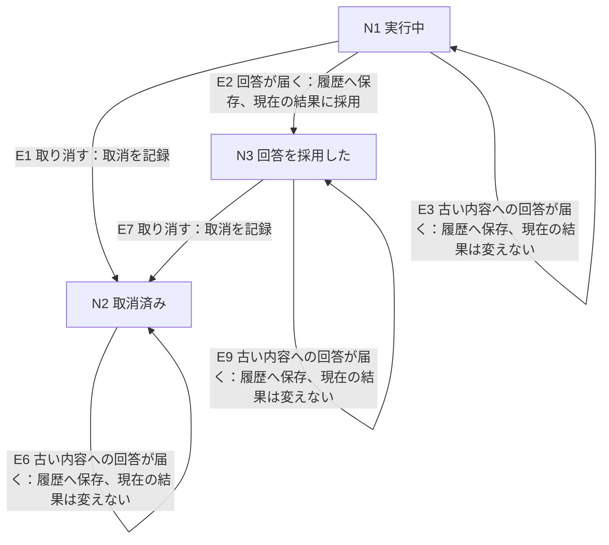

# FIG-0001 版2：取り消した実行と、届いた回答の扱い

- 種類：検証対象から作った図
- 作った時点：2026-11-13T17:47:36Z
- 元にした内容：FRM-0001 版1（model/CancelRule.lean）（内容の印 c2c9c21be058）
- 使った検証結果：EVD-0001（形式証明、検証器が受理）
- 検証結果から言えること：動作ルール（モデル）についての形式証明。コードがこのルールどおりかは、別に確かめる
- 求める保証との照合：未決。満たしたとは記録しない（GRT-0001「取り消した実行の回答・古い内容への回答で現在の結果を更新せず、回答は必ず履歴に残す」）
- 図にした範囲：実行一つを始めたあと、出来事三つまで

この図は、作った時点の内容についてのものです。その後の変更は反映していません。

## 箱（状態）

| 番号 | 状態 |
|---|---|
| N1 | 実行中 |
| N2 | 取消済み |
| N3 | 回答を採用した |

## 矢印（動き）

| 番号 | どこから | 出来事 | 起きること | どこへ |
|---|---|---|---|---|
| E1 | 実行中 | 取り消す | 取消を記録 | 取消済み |
| E2 | 実行中 | 回答が届く | 履歴へ保存、現在の結果に採用 | 回答を採用した |
| E3 | 実行中 | 古い内容への回答が届く | 履歴へ保存、現在の結果は変えない | 実行中 |
| E4 | 取消済み | 取り消す | 取消を記録 | 取消済み |
| E5 | 取消済み | 回答が届く | 履歴へ保存、現在の結果は変えない | 取消済み |
| E6 | 取消済み | 古い内容への回答が届く | 履歴へ保存、現在の結果は変えない | 取消済み |
| E7 | 回答を採用した | 取り消す | 取消を記録 | 取消済み |
| E8 | 回答を採用した | 回答が届く | 履歴へ保存、現在の結果に採用 | 回答を採用した |
| E9 | 回答を採用した | 古い内容への回答が届く | 履歴へ保存、現在の結果は変えない | 回答を採用した |

## 確かめていないこと

- 検証器とは別の検査器での再検査はしていない
- 保証要求に対して足りないもの：この保証要求（版 1）は、利用者がまだ採用していない
- 前提（確かめていない）：回答を受け取ってから現在の結果を更新するまでの間に、別の出来事は割り込まない
- 前提（確かめていない）：履歴への保存は失敗しない
- 前提（確かめていない）：回答が現在の内容に対するものかどうかは、正しく判定されて渡される
- 対象外：取り消していない実行が複数あるときに、どの回答を現在の結果とするか
- 対象外：採用したあとで実行を取り消した場合に、現在の結果を取り下げるかどうか

## 指摘の返し方

箱や矢印の番号を添えてください。例：「E3 について：取り消したあともここを通るのか」
