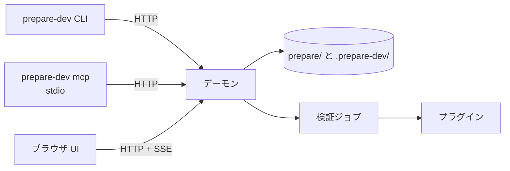

# 未確定項目の具体化案

前提は [引き継ぎ記録](records/2026-11-08-handoff.md) のとおり。自作する、BMADとPDD Kitは使わない、検証の言語とツールはプラガブルにする、という決定は維持する。

本体の runtime は TypeScript／Node.js、判断用 UI は React、記録は Markdown＋構造化データとする。エージェントは skill から CLI を使う。MCP は任意の接続経路とし、登録を必須にしない（[DEC-0004](../prepare/decisions/DEC-0004.md)）。2026-11-09 の仕様変更で json-render の採用を取りやめた（[DEC-0005](../prepare/decisions/DEC-0005.md)）。判断画面は質問データから React の部品で描画し、AI に画面構成の JSON を生成させない。変更範囲と受入条件は [DES-0002](../prepare/designs/DES-0002.md) に記録する。

引き継ぎ原文と M1 の検証記録は当時の記録として残す。2026-11-09にReact UIへの移行とCLI tarballの梱包を実装した。現行の配布仕様は [DES-0003](../prepare/designs/DES-0003.md)、検証結果は [配布検証記録](2026-11-09-release-verification.md) を参照。配布・起動の旧案も DEC-0004 による整理の対象であり、本書の過去の MCP 登録前提を再採用する根拠にはしない。

三つの「言語」を区別する。

| 何の言語か | 扱い |
| - | - |
| ツール本体の実装言語 | TypeScript／Node.js（提示済みの構成案） |
| このツールで開発を支援するプロダクトの言語 | Go、Rust など。固定しない |
| 仕様や性質を表現・検証する言語 | プラグインごとに選ぶ。最初の例では Lean |

本書には当初の提案と、その後の変更を記録する。確定した判断は DEC、DES の記録を参照する。M1 の実装と検証は実施済みで、下の環境調査は初稿作成時点のもの。UIとCLI配布の現在の実装・検証範囲は上記の配布検証記録に分けて記す。

## 0. 今回確認した事実

環境はこのMac上で直接確認した。外部ツールの仕様は公式ドキュメントとソースを読んで確認し、読めなかったものは「未確認」と明記する。

| 項目 | 確認結果 |
| - | - |
| このリポジトリ | `wim-web/prepare-dev`。コミットなし、remoteなし、ファイルなし |
| Node系 | Node 26.13、pnpm 12.16、bun 1.4（mise管理）。TypeScriptはグローバル未導入 |
| Rust | rustc/cargo 1.94。Verus、Kani、CBMCは未導入 |
| Lean | Lean 4.35.0 と lake 5.0（elan）。`lean --json` で診断をJSON行出力できることを手元で確認。`lean --src-deps` は直接 import した依存ソースだけを出力し、推移的な依存は出さない（suimon で `lake env lean --src-deps Test/Trace.lean` が直接 import の3件だけを出すことを確認） |
| JVM / .NET | なし。TLC、Apalache、`quint verify`、Dafnyは追加導入が必要 |
| Lean利用実績 | `wim-web/suimon` でLeanに仕様と証明を置き、Go実装、JSON Schema、trace検査、`sorry`/`axiom` の機械検出（`bin/test`）を運用している |
| 主な言語 | 他リポジトリはNodeとGoが中心。Rustのリポジトリは見当たらない |
| Codex CLI | 0.167.0。主力環境。skillsは `.agents/skills` と `~/.agents/skills`、プロジェクト設定は `.codex/config.toml`（trusted時のみ）。feature flag で `tool_call_mcp_elicitation` が stable/有効、`enable_mcp_apps` は under development/無効。MCPの `tool_timeout_sec` は既定60秒で、サーバごとに設定で変更できる |
| Claude Code | 2.1.319。`.mcp.json`、skillsは `.claude/skills`。MCP elicitation は form と url の両方式に対応。MCP Apps（`ui://`）は描画しない。tool呼び出しの既定タイムアウトは約28時間 |
| skills共有の実績 | `rakumiso` で `.claude/skills -> ../.agents/skills` のシンボリックリンクを使用 |
| Codexの再開 | `codex exec resume <id>`、`@openai/codex-sdk` の `resumeThread`、`codex app-server`（JSON-RPC）が存在 |
| json-render | 0.22.0（core / react / mcp / shadcn）。Apache-2.0。catalogは `defineCatalog(schema, {components, actions})` でzod定義。specは `root` + `elements` のフラット構造、データ束縛はJSON Pointer。要素の `on` に `ActionBinding {action, params}` を置き、`params` は `{"$state": "/path"}` で状態を参照でき、`ActionProvider` の handlers が受ける（API資料で確認。実動作は未確認）。`@json-render/mcp` はMCP Apps前提で `@modelcontextprotocol/ext-apps` に依存 |
| 周辺ライブラリ | zod 4.6.7、`@modelcontextprotocol/sdk` 1.32.2、vitest 5.1、fast-check 4.10 |
| Verus | macOS arm向けprebuiltあり（release 0.2026.11.02）。専用のrustupツールチェーンを別途要求。`--output-json` が存在し、通常出力は `verification results:: N verified, M errors` |
| Kani | aarch64-apple-darwin対応。`cargo install --locked kani-verifier` と `cargo kani setup`。`cargo kani -Z export-json --export-json <file>` でJSON出力（形式は不安定。中断時に前回のファイルが残ることがある）。チェックの状態は SUCCESS / FAILURE / UNREACHABLE / UNDETERMINED。`--concrete-playback` で反例からRustの単体テストを生成 |
| Quint | 0.33.1（npm）。`quint run` はJVM不要の乱択シミュレーション、`quint verify` はJDK 17以上が必要な有界モデル検査 |
| EGM | [google/elephant-goldfish-model](https://github.com/google/elephant-goldfish-model)。Apache-2.0、v0.1.1（2026-11-06）、2026-09 開始、「not an officially supported Google product」。導入は plugin marketplace（`codex plugin add egm@egm`、`claude plugin install egm@egm`）。brainstorm は探索中の選択肢提示を禁止、draft は節ごとの承認ゲートと「Author Decides Architecture」（推奨・既定を付けない）、review-loop は開始前の設定確認と毎ラウンドの明示承認を要求、`egm-review` は段階ごとの再監査1回で残件を accepted trade-offs として進める、Codex では Goldfish へのホスト指示ファイル漏れが未検証（issue #237）、をいずれも本文で確認 |

## 1. 未確定項目ごとの候補と推奨

### 1.1 名前と作業場所

| 候補 | 評価 |
| - | - |
| このリポジトリ `prepare-dev` をそのまま使う | 既に作成済みで空。名前は「開発前の準備」という責務と合う |
| 別名で新規作成 | 現時点で利点がない |

推奨: リポジトリ名、プロジェクト名、CLIコマンド名、MCPサーバ名をすべて `prepare-dev` にそろえる。npm公開前なら改名は安い。対象リポジトリ内の記録ディレクトリは `prepare/`、設定と一時状態は `.prepare-dev/` とする（2章）。

### 1.2 互換性を確認するエージェント

MCP サーバー、要求管理、質問と回答、保存、検証プラグインはすべて一つの共通実装にする。エージェントごとに本体を分けない。クライアントごとに変わるのは次の範囲だけ。

| 部分 | 扱い |
| - | - |
| 要求管理、質問と回答、保存、検証プラグイン | 全クライアントで共通 |
| MCP の登録方法、起動設定、タイムアウト設定 | クライアントごとの設定ファイル |
| skills の配置先 | 配布・設置方法の差 |
| UI 埋め込みなどの追加機能 | 対応しているホストでだけ利用 |

| 確認先の候補 | 評価 |
| - | - |
| Codex CLI | 主力環境。skills、MCP、hooks がそろう。最初の確認先に向く |
| Claude Code | 対応は容易。長時間の tool 呼び出しと elicitation の url 方式が使える |
| Gemini CLI | 導入済みだが今回は確認しない |

推奨: 最初の互換性確認先を Codex CLI とし、続いて Claude Code でも同じサーバーと skills が動くことを確認する。

- skills の正本はこのリポジトリの `skills/`。利用先では各エージェントの通常の skills 配置で使う。リンクを必須にせず、導入先やコピー方法の具体化は DEC-0004 に沿って配布設計で行う。
- 中核の利用方法は skill から CLI を実行すること。任意に MCP を使う場合だけ、共通の stdio 入口 `prepare-dev mcp` を登録する。Codex と Claude Code で本体実装を分けない。
- 回答の待機時間は設定可能にし、切断後の再取得は共通処理として持つ（3.5節）。特定ホストの既定タイムアウトを設計の制約にしない。
- 停止したエージェントの起動や自動再開は、既存エージェントから MCP を呼ぶ構成の範囲外。必要になれば Codex の `codex exec resume` や SDK の `resumeThread` のような製品ごとの API に別途つなぐ。

### 1.3 本体の開発技術

TypeScript／Node.js と React を使う。型とスキーマを共有する初期案に対し、現行実装はruntimeのZodスキーマとUIの型定義が分かれている。json-render は採用しない。質問の説明・比較・選択・回答送信は React の部品で実装する。

| 項目 | 推奨 | 理由 |
| - | - | - |
| 言語と実行系 | TypeScript、Node 26、pnpm workspace | 構成案どおり。既存環境と suimon の構成に合う。bun は当面使わない |
| スキーマ | 初期案はzod 4からJSON Schemaを生成して検証に使う。現行runtimeはZodで直接検証する | JSON Schema生成とUIの型共有は未実装。7章で初期案との差として管理する |
| 記録の保存 | Markdown＋frontmatter と JSON ファイル。DB なし | 引き継ぎの方針どおり。Git 差分で読める |
| runtime | 単一のローカルデーモン。HTTP＋SSE | CLI、MCP、UI からの書き込みを一本化する |
| UI | React 19＋Vite。単一 HTML にビルドしてデーモンが配信 | 質問データを React の部品で描画する。画面の配置は UI 側で管理し、別サーバを立てない |
| 本体のテスト | vitest | 本体の TypeScript 実装をテストするためのもの。支援対象プロダクトの検証器ではない。JSON レポータがあり証拠記録に変換しやすい |

### 1.4 最初の題材

| 候補 | 評価 |
| - | - |
| runtime自身の「質問と回答の適用」手順を題材にする | 最初の例で確認したい性質（古い版への誤適用なし、二重適用なし、切断後の再取得）がそのまま検証対象になる。実装が必要な部分と重なるため無駄がない |
| 独立した小さな例（例: 予約枠の確保と解放） | 仕組みと題材を分離できるが、同じ作業を二重にやることになる |

推奨: 一つ目を採用する。要求は一件に絞る。

> REQ-0001（仮）: 人間の回答は、質問が対象にした版に対してのみ、一度だけ判断として反映される。対象の版が変わっていた場合、回答は保存されるが自動反映されず、再確認の対象になる。

対応づける主張の例を挙げる。

| 主張 | 得られる保証 | 検査する方法 |
| - | - | - |
| C1: 同じ `answer_id` の反映は高々一回 | 二重反映が起きないこと。反映が必ず完了することは含まない | Lean で状態機械をモデル化し、不変条件を帰納的に証明 |
| C2: 対象の `rev` か `sha256` が質問作成時と異なる回答は `applied` に遷移しない | 古い版への誤適用が起きないこと | 同上 |
| C3: 保存済みで未処理の回答は、中断や再起動のあとも再取得できる | 回答が失われないこと。エージェントが必ず再開することは含まない | 同上（中断と再起動をモデル上の遷移として扱う） |
| C4: 実行した trace の範囲で、TypeScript 実装の遷移がモデルと一致する | 当該 trace 集合に対するテスト結果。実装全体の証明ではない | Lean モデルから生成した trace を vitest で実装に流す適合テスト |

モデルは `question_apply` を一瞬で完了する操作として抽象化しない。意図の記録、decision の保存、質問ファイルの更新、確定の記録という保存の段階と、各段階の間での中断および再起動後の回復（3.5節）を遷移として含める。そうしないと、保存途中の中断や再取得の穴が証明の対象外に残る。

C4は「実装の性質」ではなく「モデルと実装の対応」を主張するもので、証拠記録では別の種類として残す。suimon の `gen` と `check` と同じ構造である。Lean の証明と vitest の成功を並べても、TypeScript 実装全体を形式証明したことにはならない。

この題材では、開発対象のプロダクトがこのツール自身（TypeScript 実装）なので、実装側の証拠に vitest が出てくる。Go や Rust のプロダクトを支援するときは、そのプロジェクトのテスト・検証手段を同じ証拠形式に変換する別のプラグインを使う。

### 1.5 検証バックエンド

最初の例で確認したい性質は、回答の保存、受信、反映、中断、再取得が任意の順序と回数で起きても不変条件が保たれることである。任意長の操作列に対する不変条件を帰納的に証明し、状態機械と trace 生成用の実行可能定義を同じプロジェクトで管理したい。有限状態のモデルなら到達状態グラフの探索（TLC など）でも任意長の実行を扱えるので、証明でなければ扱えない性質だとは主張しない。

この条件を満たしたうえで、導入リスクが小さく、出力を機械で読めるものを一つ目にする。

| 候補 | 証拠の種類 | 導入 | 出力 | 評価 |
| - | - | - | - | - |
| Lean 4 | 証明（カーネル検査、公理を明示） | 導入済み | `lean --json`、`#print axioms` | suimonで運用実績。モデルレベルなので実装との対応は別主張 |
| vitest（＋fast-check） | テスト | npm | JSONレポータ | TS実装に対する証拠。formalではないが証拠の種類として必要 |
| Kani | 有界検査＋反例 | cargo、arm64対応 | テキスト、反例からテスト生成 | コードレベル。Rustが現在の主要言語ではない |
| Verus | 証明（Rustコード上） | prebuilt、別ツールチェーン | `--output-json` | 同上 |
| Quint | 乱択シミュレーション／有界モデル検査 | npm、verifyはJDK | ITF trace | モデルレベル。TS生態系に近い |
| TLA+ / Alloy | モデル検査 | JDK | テキスト | JDKが必要で、Quintと役割が重なる |

推奨:

- 一つ目のプラグインは `lean4`。理由は、任意長の操作列に対する不変条件を帰納的に証明できること、状態機械の定義、不変条件の証明、trace 生成用の実行可能定義を一つのプロジェクトに置けること、`lean --json` で結果を読め、`lean --src-deps` を再帰的に使って依存ソースを機械的に列挙できること、suimon で同じ構造を運用済みで導入作業がないこと。Lean に固定する意図ではなく、最初の検証例としての選択である。
- `#print axioms` で分かるのは論理公理への依存だけで、定理に書いた仮定や、定理文が要求を正しく表しているかは分からない。結論をそのまま仮定に置けば公理も `sorry` もなしに証明できる。そのため証拠には、検査した定理名、仮定を含む定理の完全な命題、対応する承認済み仕様の版、モデルの初期状態・許可する遷移・対象外の条件を含める（2.5節、4章）。
- 本体の TypeScript 実装に対する証拠は `vitest` プラグインで扱う。これは検証バックエンドではなく、テストという証拠の種類を同じ記録形式に乗せるためのものである。これで初回から「証明」「テスト」「モデルと実装の対応」の三種類が区別される。
- 二つ目（性質の異なる手法）は Kani を第一候補にする。言語（Rust）、レベル（コード）、有界性、反例の有無がすべて Lean と異なり、抽象化の偏りを最も強く試せる。Rust を扱わない方針なら Quint を代替にする。この決定は手順4まで保留できる。

### 1.6 データとAPI

2章から4章に案を書く。

### 1.7 配布と起動

| 項目 | 推奨 |
| - | - |
| 開発中 | このリポジトリで `pnpm` から直接実行。npm公開は後回し |
| 対象リポジトリへの導入 | CLI と通常の skills 配置で利用でき、MCP 登録を必須にしない。配布物の梱包・導入手順は DEC-0004 に沿って別途設計する。現実装の `init` はまだ MCP 設定を書き込むため、移行未完了 |
| 起動 | CLIとMCP入口はデーモンへ接続し、いなければ起動する。デーモンは `.prepare-dev/daemon.json` にポートとPIDを書く |
| UI | `prepare-dev ui` または質問作成時に返されるURLをブラウザで開く。`127.0.0.1` のみに束縛する |

## 2. データ形式の案

### 2.1 配置

```
<対象リポジトリ>/
  prepare/                      人間が読む正本。Git管理
    discovery/DIS-0001.md
    requirements/REQ-0001.md
    decisions/DEC-0001.md
    designs/DES-0001.md
    specs/SPEC-0001.md
    questions/Q-0001.json        質問と回答
    runs/RUN-0001.json           検証実行記録
    runs/RUN-0001/               生ログ、反例、生成テスト
    events.jsonl                 永続の追記ログ。書き込みごとの sha256、外部変更の検出、適用の意図と確定、受領、終了
  .prepare-dev/
    config.json                  プラグイン、パス、待機時間の既定値
    index.json                   id→path、rev、sha256 の検索用キャッシュ。events.jsonl と実ファイルから再生成でき、判定には使わない
    daemon.json                  起動中デーモンの情報（Git対象外）
```

IDは種類ごとの接頭辞と連番にし、改名や移動で変えない。主張は仕様ID配下の `SPEC-0001/C1` のように表す。

### 2.2 Markdown の共通 frontmatter

```yaml
---
id: REQ-0001
kind: requirement          # discovery | requirement | decision | design | spec | review | record
title: 回答は依頼した版にのみ一度だけ反映する
status: proposed           # draft | proposed | accepted | rejected | superseded
rev: 3
created: 2026-11-08
updated: 2026-11-08
links:
  derived_from: [DIS-0001]
  rationale: [DEC-0002]
  specified_by: [SPEC-0001]
  supersedes: []
---
```

種類ごとの追加項目。

| kind | 追加項目 |
| - | - |
| requirement | `priority`（must/should/could/wont）、`acceptance`（本文内の受入条件ID一覧）、`coverage`（観点ごとの状態: decided / hypothesis / unverified / out_of_scope） |
| decision | `question`（Q-ID）、`answer`（answer_id）、`chosen`、`alternatives`、`reviewed`（対象のid・rev・sha256の一覧）。`answer` を持つ decision は `question_apply` だけが作成・確定する |
| design | `alternatives`、`tradeoffs`、`chosen` |
| spec | `claims`（下記）、`assumptions`、`out_of_scope` |
| review | `subjects`（レビュー対象の id・rev・sha256 の一覧）、渡した資料、persona の版、指摘、AI が提案した処理と実際に行われた処理、未対処の一覧。詳細は M2 で具体化（5.1節） |

spec の `claims` は検証との接点になる。

```yaml
claims:
  - id: C1
    statement: 同じ answer_id の反映は高々一回
    requirement: REQ-0001
    native:
      - plugin: lean4
        ref: PrepareDev.Answer.applied_at_most_once   # 定理名
      - plugin: vitest
        ref: answer-protocol.spec.ts::applies once     # テスト名
```

承認は独立した記録にせず、レビュー種別の質問への回答から作る decision に `reviewed` として対象の `id`、`rev`、`sha256` を残す。現在の rev と一致しない承認は「過去の版への承認」として表示する。

### 2.3 版の扱い

- runtime 経由の書き込みごとに `rev` を1増やし、書き込み後の sha256 を `events.jsonl` に `record.write` として残す。`index.json` はその写しにすぎない。
- 読み出し時に、`events.jsonl` にある最後の sha256 と実ファイルの sha256 が一致しなければ外部編集とみなし、`rev` を増やして `external_change` を記録する。frontmatter の `rev` が書き換えられていなくても検出できる。
- 更新（`record_put`）と回答の反映（`question_apply`）では、期待する `rev` と `sha256` の両方を、index ではなく現在の実ファイルに照らして確認する。どちらかが違えば拒否する。index を削除・再生成しても判定は変わらない。
- 質問、承認、検証記録は対象を `{id, rev, sha256}` で指す。rev は人間向けの通し番号、sha256 は内容の特定用で、改ざん防止や意味の正しさの保証には使わない。

### 2.4 質問と回答（JSON）

```json
{
  "id": "Q-0012",
  "rev": 1,
  "state": "answered",
  "kind": "single_choice",
  "created_at": "2026-11-08T10:00:00+09:00",
  "created_by": { "host": "codex", "session": "0199a213-..." },
  "subjects": [{ "id": "REQ-0001", "rev": 3, "sha256": "…" }],
  "prompt": "回答の対象版が変わっていた場合の扱いを決めてください。",
  "options": [
    { "key": "hold", "label": "保存して再確認", "recommended": true, "reason": "…" },
    { "key": "apply", "label": "そのまま反映", "reason": "…" }
  ],
  "allow_free_text": true,
  "answers": [
    {
      "answer_id": "ANS-0012-1",
      "answered_at": "2026-11-08T10:05:00+09:00",
      "subjects_at_answer": [{ "id": "REQ-0001", "rev": 3, "sha256": "…" }],
      "stale": false,
      "choice": ["hold"],
      "text": null,
      "received_at": null,
      "applied_as": null,
      "closed": null
    }
  ]
}
```

- `state` は `open → answered → received → applied` と `cancelled`、`closed`。「保存した」「受け取った」「反映した」「反映せずに終えた」を分ける。
- 回答時に対象の `rev` か `sha256` が作成時と異なれば `stale: true` を付けて保存する。自動では反映しない。再確認の対象として未処理一覧に残る。
- 未処理とは「確定済みの適用（`events.jsonl` の `apply.commit`）も `closed` も持たない回答」のこと。`received_at` が付いていても未処理に含める。Q の `applied_as` は確定の写しであり、対応する commit がない `applied_as` は仮更新として無視する。
- `prompt` と `options` を質問の正本とし、React の UI が描画する。`prompt` は背景・判断点・人に尋ねる理由を含む説明で、Markdown の段落・箇条書き・表を表示できる。`options[].summary` に選択の帰結、`recommended` と `reason` に推奨と理由を持たせる。比較が必要なら説明に表を含める。
- 質問作成は CLI・MCP・HTTP から同じ質問データを受け取る。画面レイアウト用の `ui`、`ui.spec`、catalog、および画面 JSON の生成・検証は契約から外す。CLI に画面 JSON の入力機能は追加しない。
- 一つの質問は一つの独立した判断を扱う。複数の判断は別の質問にする。`multi_choice` は一つの判断で複数の候補を選ぶために使い、独立した判断を接頭辞でまとめない。
- 旧 `GET /api/questions/:id/ui` とその呼び出しを廃止し、UI は質問データから描画する。既存の質問と回答は保持し、残存する `ui.spec` は新しい表示に使わない。新しい質問の正本には `ui.spec` を含めない。入力 API・UI・runtime・依存パッケージを同じ実装変更で更新した。この移行はSPEC-0004と配布検証記録で確認済み。

### 2.5 検証実行記録（JSON）

```json
{
  "id": "RUN-0007",
  "plugin": { "name": "lean4", "version": "0.1.0" },
  "tool": { "name": "lean", "version": "4.35.0", "extra": { "lake": "5.0.0" } },
  "method": "proof",
  "claims": [
    {
      "spec": { "id": "SPEC-0001", "rev": 2, "sha256": "…" },
      "claim": "C1",
      "requirement": { "id": "REQ-0001", "rev": 3, "sha256": "…" },
      "native": { "theorem": "PrepareDev.Answer.applied_at_most_once", "statement": "∀ (t : Trace), Reachable init t → …" }
    }
  ],
  "targets": [{ "kind": "lean_module", "path": "model/PrepareDev/Answer.lean", "sha256": "…" }],
  "inputs": {
    "files": [
      { "path": "model/PrepareDev/Model.lean", "sha256": "…", "role": "import" },
      { "path": "model/lake-manifest.json", "sha256": "…", "role": "dependency_lock" },
      { "path": "model/lean-toolchain", "sha256": "…", "role": "toolchain" }
    ],
    "config": { "allowed_axioms": ["propext", "Classical.choice", "Quot.sound"] }
  },
  "environment": { "platform": "darwin-arm64", "started_at": "…", "duration_ms": 8200 },
  "result": "verified",
  "assumptions": ["axioms: propext, Classical.choice, Quot.sound"],
  "scope": { "bounded": false, "bounds": null, "excluded": [] },
  "artifacts": [{ "kind": "log", "path": "prepare/runs/RUN-0007/lean.jsonl" }],
  "summary": "applied_at_most_once を含む3定理を検査。sorry なし。"
}
```

- `method` は `proof | model_check | bounded_check | simulation | test | static_analysis`。
- `result` は `verified | failed | unknown | timeout | tool_error | unsupported`。`verified` の意味は `method` と `scope` と `assumptions` を合わせて初めて決まる。有界検査の `verified` は `scope.bounds` を必須にする。
- 検証実行は、対応する要求・仕様の `{id, rev, sha256}` と、実際に検査した入力一式を特定する。`inputs.files` には対象ファイル自身と、import を推移的にたどった依存ソースすべてを重複なく含め、さらに import 列挙では得られない入力（ツールチェーン、Lake の設定と依存ロック、生成ソースとその生成条件、検証設定）を別途含める。C4 ではモデル、実装、trace 生成器、適合テストも含める。
- `claims[].native.statement` には仮定を含む定理やテストの完全な命題を残す。定理名だけでは、仮定に結論を置いた証明と区別できない。
- `claims` が指す要求・仕様、`targets`、`inputs.files` のいずれかの sha256 が現在と一致しない記録は、結果を保持したまま「現在版への適用は未確認」として扱う。`status` と `trace` はそれを現在の成功として表示しない。
- 反例や生成テストは `artifacts` に `counterexample` や `generated_test` として残す。

## 3. runtime と API の案

### 3.1 プロセス構成



- 書き込みはデーモンだけが行う。CLI と MCP 入口はデーモンの HTTP クライアント。
- デーモンは対象リポジトリごとに一つ。`.prepare-dev/daemon.json` で発見し、なければ入口が起動する。
- MCP を使う場合は共通の入口を登録する。CLI とブラウザ UI の利用に MCP の登録は不要。

### 3.2 MCP tools（最小構成）

| tool | 役割 |
| - | - |
| `status` | 未処理の回答（`question_pending` と同じ集合）、回答待ちの質問（人がまだ答えていないもの。対象の版が変わったかどうかつき）、未対処のレビュー指摘、現在の版と不一致の承認・証拠、進行中ジョブ、回復待ちの適用の一覧 |
| `record_list` / `record_get` | 記録の一覧と取得（frontmatter と本文、現在の rev と sha256） |
| `record_put` | 記録の作成・更新。`expected_rev` と `expected_sha256` を現在の実ファイルと照合し、一致しなければ拒否。回答に由来する decision はこの操作では確定できない（`answer` を持つ decision の作成・変更は拒否） |
| `question_create` | 質問を登録し `question_id`、`rev`、UIのURLを返す |
| `question_wait` | 回答が来るか `timeout_ms` までブロック。来なければ `pending` を返す |
| `question_pending` | 未処理の回答一覧。受領済みかどうかにかかわらず、未適用かつ `closed` でない回答を返し、`stale` な回答も再確認対象として含める。確定済みかどうかは `events.jsonl` の `apply.commit` で判定し、Q の `applied_as` だけでは確定とみなさない |
| `question_ack` | 受領の記録。`received_at` を付けるだけで、未処理一覧から外す条件にはしない |
| `question_apply` | 回答を判断として確定する操作。質問の現在版、対象の `rev` と `sha256`、適用済み状態を確認し、decision の確定と回答の適用記録を一つの論理コミットとして保存する。同じ `answer_id` の再試行には既存の適用結果を返す。エージェントは decision の案（本文と理由）を引数で渡す。確定点は `apply.commit` の永続化で、それ以前の DEC と Q の変更は仮更新（3.5節） |
| `question_close` | 回答を反映せずに処理済みにする。理由（取り下げ、再質問で置き換え、など）を必須にする |
| `question_cancel` | まだ回答のない質問を取り消す。理由を必須にし、対象の改訂で作り直したときは新しい質問の id（`replaced_by`）を残す。回答のある質問は取り消せず、回答ごとに `question_apply` か `question_close` で処理する（M2） |
| `verify_run` | プラグイン、主張、対象を指定してジョブを起動し `run_id` を返す |
| `verify_wait` / `verify_get` | ジョブの完了待ちと記録の取得 |
| `trace` | 要求IDから判断、仕様、主張、検証記録、review を現在の版との一致有無つきで返す。`links`（`derived_from`、`specifies`、`rationale_for` など）を両方向にたどり、つながる記録を `links` に返す。質問は `subjects` から引くので、質問の id を記録に書き戻す必要はない |
| `review_bundle` | 正本の記録群を版固定（`{id, rev, sha256}`）で一つの Markdown にまとめ、関連する確定済み `DEC-*` を自動で加える。`.prepare-dev/reviews/` に書き出せる（M2） |

`question_wait` の待機時間は `timeout_ms` 引数と `.prepare-dev/config.json` の既定値で調整できる。`pending` が返ったら再度 `question_wait` を呼ぶ手順は skill に書く。ホスト側の tool タイムアウト（Codex の `tool_timeout_sec` など）は設定で変更できるので、待機時間の既定値はホストの既定に合わせるのではなく、複数クライアントでの使いやすさを見て決める。

### 3.3 CLI

`prepare-dev init | serve | ui | status | q list | q show <id> | q answer <id> ... | record create|get|put ... | bundle ... | verify run ... | trace <id> | mcp`。CLI は人間とスクリプトのための入口で、MCP と同じ HTTP API を叩く。frontmatter は `--fm key=value` か `--fm-file <json>`（長い配列向け）、本文は `--body-file` で渡す。

### 3.4 HTTP と SSE

`/api/*` に 3.2 と同じ操作、`/events` に SSE（質問の追加、回答、ジョブ進捗、外部変更）。UI は同じオリジンから配信する。

### 3.5 回答の流れと状態

1. エージェントが `question_create` を呼ぶ。runtime が `Q-xxxx.json` を保存し、UIに表示する。
2. エージェントが `question_wait` を呼ぶ。
3. 人間がUIで回答する。runtime が対象の `rev` と `sha256` を実ファイルで確認し、`stale` を判定してから回答を保存する（先に保存、次に通知）。
4. 待機中の接続があれば回答を返す。なければ次の `question_wait` か `question_pending` で返す。
5. エージェントは `question_ack` で受領を記録する。これは未処理一覧から外す操作ではない。
6. エージェントは decision の案を作り、`question_apply` で確定する。確定しない場合は `question_close` で理由とともに終える。どちらも呼ばれない回答は、次のセッションでも `question_pending` に残る。

`question_apply` の保存は複数ファイルにまたがるため、次の順序で行い、中断からの回復手順を決めておく。単一デーモンでも、複数ファイルの保存が自動的に一つの操作になるわけではない。

| 段階 | 書き込み |
| - | - |
| a. 意図 | `events.jsonl` に `apply.intent {txid, answer_id, decision_id, subjects: [{id, rev, sha256}]}` を追記して fsync。`decision_id` はここで採番する |
| b. decision | `DEC-xxxx.md` を一時ファイルに書いて rename |
| c. 質問 | `Q-xxxx.json` の該当回答に `applied_as` を付け、一時ファイルから rename |
| d. 確定 | `events.jsonl` に `apply.commit {txid}` を追記して fsync |

確定点の契約は次のとおり。ファイルの存在や `applied_as` の有無だけで確定したとは判断しない。

- **`apply.commit` の永続化（段階 d）を、判断反映の唯一の確定点とする。** それ以前に保存した DEC と Q の変更は仮更新であり、`status`、`trace`、`question_pending`、後続の処理は、commit のない仮更新を確定済みの判断として扱わない。
- 起動時に、`apply.commit` も `apply.abort` もない `apply.intent` があれば回復する。回復が終わるまで通常の操作は受け付けない。意図に記録した対象の `rev` と `sha256` を現在の実ファイルと照合し、一致すれば同じ `decision_id` で b 以降をやり直す（既に済んでいる段階は飛ばす）。一致しなければ `apply.abort` を記録し、仮更新を撤回する。撤回では、書きかけの DEC を取り除き、Q の該当回答から `applied_as` を外して `stale: true` を付け、未適用の再確認対象へ戻す。
- **確定済みの操作は、その後に対象の版が変わっても abort しない。** 過去の版に対する確定結果として保持し、`trace` では確定時の版と現在の版を区別して表示する。対象が変わっていれば abort する規則は、未確定の操作にだけ適用する。
- 同じ `answer_id` の再試行は、`apply.commit` があれば既存の `decision_id` と結果を返し、未確定の `apply.intent` があれば回復処理を先に完了させてからその結果を返す。decision が重複しない根拠は、採番が意図の記録と同時に一度だけ起きることにある。
- `abort` の追記と仮更新の清掃は別の保存段階であり、その間の再中断も扱う。未確定取引がなくても未清掃の abort があれば `recovery_pending = true` とし、通常操作を受け付けない。再起動は abort 済み取引も再清掃する。C3 の整合性は回復待ちでない状態に適用する。
- 操作単位のモデルで C1〜C3、取り消し清掃の段階モデルで C5 を証明する。モデルの生成 trace と実装の対応、および API・SSE が仮適用印を公開しないことは C4〜C6 のテストで確認する。モデル上の証明を実装全体の証明とは扱わない。

回答の保存と再取得（`question_pending`）はどのクライアントでも共通に持つ。待機時間は設定項目で、再取得処理とは分けて設計する。

elicitation と MCP Apps は、どちらも任意の追加経路とする。

| 経路 | 役割 | 位置づけ |
| - | - | - |
| CLI＋ブラウザ UI | skill から質問を登録し、UI で回答、CLI で待機・再取得 | 中核。MCP 登録なしで成立させる（DEC-0004） |
| 通常の MCP＋ブラウザ UI | 同じ runtime の質問・回答操作を MCP から呼ぶ | 任意の接続経路 |
| elicitation | ホストの会話内で簡単な選択を取る（form）か、UI の URL を開かせる（url） | Claude Code は両方式に対応。Codex は `tool_call_mcp_elicitation` が有効だが url 方式は未確認 |
| MCP Apps | 対応ホストの会話内に判断画面を埋め込む追加経路 | 任意。今回の実装対象に含めず、json-render を前提にしない |

判断用 UI はローカルブラウザで成立させる。MCP Apps を後から検討する場合も、質問・回答の正本と runtime の契約を共用する。埋め込み方式は別途具体化する。

### 3.6 検証ジョブ

以下は初期の設計案。進捗と実出力による結果判定は実装済み。キャンセル操作・同時実行1本の制限は未実装で、タイムアウトは各検証器の実行処理が持つ。未実装部分を実装済みとは扱わず、7章にも差を記録する。

- ジョブは `run_id` を持ち、進捗イベントを SSE と `verify_wait` に流す。タイムアウトとキャンセルは runtime が管理する。
- 結果の `result` はプラグインの parser が実出力から決める。エージェントが「検証済み」と書いても記録にはならない。
- 同時実行は初回は1本にする。

## 4. 検証プラグインの境界の案

```ts
export interface VerificationPlugin {
  name: string;
  version: string;
  capabilities(): {
    languages: string[];            // ["lean4"]
    methods: Method[];              // ["proof"]
    properties: string[];           // ["invariant", "refinement", ...]
    requires: { tools: ToolRequirement[]; platforms?: string[] };
  };
  guidance(): { docs: string[]; templates: string[] };   // エージェントが読む書き方の資料
  detect(ctx: Ctx): Promise<{ available: boolean; versions: Record<string, string>; reason?: string }>;
  run(job: VerifyJob, ctx: Ctx & { signal: AbortSignal; onProgress(e: ProgressEvent): void }): Promise<RawOutput>;
  parse(raw: RawOutput, job: VerifyJob): EvidenceRecord;   // 2.5 の形式
}
```

| プラグイン | runner | parser | 結果の対応 |
| - | - | - | - |
| `lean4` | `lake env lean --src-deps` は直接 import の依存ソースしか出さないので、得られた各ファイルに対して同じ環境で再帰的に実行し、対象自身と推移的な依存ソースを重複なく `inputs.files` に集める。`lean-toolchain`、`lakefile.*`、`lake-manifest.json`、生成ソースがあればその生成条件も別途記録する。続けて `lake build <targets>` を実行。続けて生成した一時ファイルで `#check <定理>` と `#print axioms <定理>` を `lake env lean --json` で実行 | JSON行の `severity` と本文、`sorry` 警告、定理の完全な命題、公理一覧 | ビルド成功かつ `sorry` なしかつ公理が許可一覧内なら `verified`（`assumptions` に公理、`claims[].native.statement` に命題）。`sorry` あり → `unknown`。型エラー → `failed`。lean/lake 不在 → `unsupported` |
| `vitest` | `vitest run --reporter=json --outputFile=…` | テストごとの状態と失敗メッセージ | 全成功 → `verified`（`method: test`、`scope` に実行テスト名）。失敗 → `failed` と失敗箇所を `counterexample` 相当で保存 |
| `kani`（候補） | `cargo kani --harness … --default-unwind N -Z export-json --export-json <run固有のパス>` | JSON のハーネス結果とチェック状態（SUCCESS / FAILURE / UNREACHABLE / UNDETERMINED）。形式が不安定なので Kani の版を固定し、`started_at` を実行時刻と照合する。`--concrete-playback=print` の生成テスト | 全チェック SUCCESS → `verified` with `scope.bounds = {unwind: N}`。FAILURE → `failed` と生成テストを `generated_test` に保存。UNDETERMINED → `unknown`。UNREACHABLE は成立しても空虚な可能性があるので `summary` に明記 |

## 5. skills の案

`.agents/skills/` に置く。入口は一つで、工程の選択はエージェントが行う。

| skill | 役割 |
| - | - |
| `prepare-dev` | 入口。`status` と `trace` で現状を読み、次に必要な工程を選ぶ。人間に聞く前に調査と候補作成を済ませる手順を含む |
| `prepare-discover` | 誰の何の問題か、現状、代替、仮説、非目標。記録は `DIS-*` |
| `prepare-requirements` | 観点一覧（利用者、通常・例外シナリオ、用語、データ、状態、規則、品質、制約、優先順位、受入条件、根拠）と `coverage` の埋め方。記録は `REQ-*` |
| `prepare-design` | 案の比較と採否。記録は `DES-*` と `DEC-*` |
| `prepare-specify` | 要求を主張へ変換し、プラグインの `guidance` を読んでネイティブ仕様を書く。記録は `SPEC-*` |
| `prepare-verify` | 承認した仕様の版を入力に、対象コード・証明・テストを作成または更新し、`verify_run` で検査する。失敗は実装・証明・テストの修正へ戻す。要求や仕様の矛盾を見つけた場合だけ判断の工程（`prepare-design` / `prepare-requirements`）へ戻す。通常の実装ミスを直すループと、要求自体を見直すループを分け、検証を通すために要求を黙って弱めない |
| `prepare-review` | 抜け、矛盾、現在の版と不一致の承認・証拠の洗い出し |

各 skill に終了条件を書き、観点を空欄のまま完了にしない。質問を作るときは候補と推奨理由を先に用意することを必須にする。質問は工程の途中ではなく終わりに作るが、独立した判断ごとに一つにする（質問一つは `kind` 一つと `options` 一組、回答一つが `DEC-*` 一件）。複数の判断を選択肢の接頭辞で一つの質問に詰めると、回答の適用も判断の記録も一つに混ざる。質問を作ったあとは回答まで対象の記録を変えない（版が進むと回答が `stale` になる）ので、レビューの修正を済ませてから質問を作る。

### 5.1 EGM を土台にする範囲（M2 で具体化）

Google の [Elephant-Goldfish Model](https://github.com/google/elephant-goldfish-model)（EGM）を、上流とレビューの skill の土台にする。設計を進めるエージェント（Elephant）と、会話履歴なしで文書だけを読むレビュー役（Goldfish）を分け、人がトレードオフを判断する構造は本書の方針と同じである。ただし plugin として導入はせず、persona と評価基準を元の版（commit）を特定して写し、対話と実行の制御は本書の方針に合わせて書き直す。

| 扱い | 対象 | 内容 |
| - | - | - |
| 流用（版を固定） | reviewer persona（comprehension、design critic、zoom out、implementation readiness など）、`resources/document_standards/` | 文書の理解を自分の言葉で言い直させ、意図とのずれを指摘にする comprehension テスト。最初と中間の Zoom Out で、そもそも必要か、過剰設計や脱線がないかを見る5段階 |
| 規則だけ流用 | `egm-review-loop` の指摘管理 | 指摘に安定 ID を付ける。settled（反論済み・受容済み）の指摘は、対象と根拠が引き続き成立する範囲では再開しない。関連する仕様や判断の版が変わったら再確認する。修正の適用は settle ではない。Nit は進行を止めない。失敗・未応答の reviewer は「指摘なし」に数えず「未実施」として記録する。収束の判定は「連続2ラウンドの clean」ではなく、BRAINSTORM を段階ごとに一回だけ行い、直した箇所への REVIEW の再確認で新しい Blocker と Major が出ず、未対処の Blocker と Major がないこと（BRAINSTORM は毎回新しい Major を出すので、それで収束を測ると終わらない。例で確認）。上限は段階ごとに四 round |
| 書き換え | brainstorm と draft の対話規則、review-loop の進行規則 | 探索中に選択肢を出さない、節ごとに承認、推奨を付けない、開始前の設定確認と毎ラウンドの明示承認、は採らない。AI が調査して候補と推奨理由を作り、許可済みの範囲の調査・修正・再確認は進める。既存の決定を変えるとき、リスクを受容するとき、判断が必要な未解決事項が残ったときに人へ返す |
| 変更 | `egm-review` の再監査上限での自動受容 | 上限到達は「未解決のまま停止」。受容するなら理由を持つ判断として `question_apply` で `DEC` に残す |
| 採らない | EGM の成果物配置（`concepts_brief.md`、`design_draft.md`、`docs/designs/`、`*_report.md`） | 正本を二重にしない。内容は下の対応で `prepare/` の記録に置く |

EGM の成果物と記録の対応は次のとおり。「何を満たすか」と「どう作り、どう確かめるか」を分ける。

| EGM の内容 | prepare-dev の置き場所 |
| - | - |
| 問題の探索、仮説、議論の経緯（brief の前半） | `DIS` |
| 達成したいこと、要求、制約 | `REQ` |
| 採用した選択肢、棄却した代替案とその理由、判断の根拠（brief の決定事項、設計書の Alternatives Considered） | `DEC` |
| 構成、責務、データの流れ、設計上の説明（Technical Plan、非機能要求） | `DES` |
| 守るべき振る舞い、状態遷移、不変条件、検証する性質 | `SPEC` |
| 変更するファイル、実装順序、検証の方法（Detailed Implementation Plan、Verification Plan） | `DES` の実装・検証計画の節。verify の実行前にレビューできる形で置く。新しい記録種別は増やさない |
| レビューの指摘と処理 | `review` 記録（下記） |
| 検証器やテストを実際に動かした結果 | `RUN` |

正本を複数の記録に分けるので、レビュー役には必要な `REQ`・`DEC`・`DES`・`SPEC` と計画を、版（`{id, rev, sha256}`）を固定してまとめて渡す。EGM の評価基準は問題・目標・構成・代替案・リスクをまとめて確認するものなので、`DES` 一枚だけに当てると、別の記録に書いてある事項を欠落と指摘する。何を渡したかは review 記録に残す。

EGM の draft にある「前段の決定との照合」は、`DIS`・`REQ`・`DEC` の決定事項と設計・仕様の内容を比べ、矛盾は全件報告し、新しい決定はアーキテクチャ・外部インターフェース・依存関係に関わるものだけ報告する。自動では直さず、人が決める。

`review` 記録は M2 で具体化する。M1 で決めておくのは、対象を `{id, rev, sha256}` で参照する方式を再利用することだけ。少なくとも次を区別する。

- 指摘（安定 ID、severity、対象範囲、内容、根拠）
- AI が提案した処理（EGM の PROPOSE FIX / CONTEST / ESCALATE / DECLINE に相当）と、実際に行われた処理（修正を適用した、反論を人が認めた、質問として人に回した、未対処のまま）。提案は完了ではなく、反論は指摘の誤りの確定ではない
- 未対処の指摘の一覧。EGM の `egm-resolve` は未対処が残っていても報告書を `Status: resolved` にするので、これを「全件解決」と解釈しない
- リスク受容は理由を持つ判断として `DEC` に残し、review 記録から参照する

レビューの結果は、何を誰に読ませ、何が指摘され、どう判断したかの記録であり、検証器による保証としては扱わない。レビューの指摘が解決しても `RUN` の `result` は変わらない。

Codex では Goldfish にホストの指示ファイル（AGENTS.md など）が届く可能性があり、除外は未検証（EGM issue #237）。レビュー役に渡した入力を記録に残すのはこのためでもある。review 記録の `inputs` は bundle に入れた記録の版だけで、レビュー役が自分で読んだリポジトリのファイルは含めない（読んだファイルは報告の本文に書かせる）。指摘の id は review 記録の中で一意とし、他から参照するときは `REV-xxxx/f1` の形にする。

具体例（`DIS-0001`、`REQ-0002`〜`0008`）で確認した点: comprehension の言い直しは四回とも意図と一致したが、一致したことで問題文と推奨案のずれが露出した。BRAINSTORM の persona は round ごとに三〜四件の新しい Major を出し、前の指摘を再開することはなかった。persona 一つの round は十万 token 前後かかる。`REQ-*` の design_critique に `feature-spec-standard` を当てると設計の高さの指摘（ロックファイル、ハッシュ方式）が混ざるので、高さを要求に留める注記を渡す。

## 6. リポジトリ構成とマイルストーン1

```
prepare-dev/
  package.json  pnpm-workspace.yaml  tsconfig.base.json
  packages/core       zodスキーマ、ID、rev/sha256、trace
  packages/runtime    デーモン、保存、HTTP+SSE、質問と回答、ジョブ、プラグインホスト
  packages/mcp        stdio の MCP 入口
  packages/cli        CLI
  packages/ui         React の判断用 UI。単一HTMLにビルド
  plugins/lean4
  plugins/vitest
  skills/             .agents/skills の正本（対象リポジトリへ配置）
  model/              マイルストーン1のLeanモデル（lakeプロジェクト）
  prepare/            このプロジェクト自身の記録（dogfooding）
  docs/
```

マイルストーン1の完了条件は次のとおり。すべて実際に動かして確認する。

1. `REQ-0001` と、その理由を持つ `DEC-*` が runtime 経由で作成され、`trace` で追える。
2. UIから回答すると `Q-*.json` に保存され、`question_wait` 中のエージェントに返る。
3. `question_wait` を中断してから回答しても、`question_pending` で回収できる。
4. `question_ack` のあと `question_apply` の前に中断しても、次のセッションの `question_pending` にその回答が残る。
5. 回答後に対象を編集して rev を上げると、その回答は `stale` となり `question_apply` が拒否する。
6. 対象を rev を変えずに外部編集し、`index.json` を削除して再生成しても、古い回答の `question_apply` は拒否される。
7. 同じ `answer_id` に `question_apply` を二度呼んでも反映は一度で、二度目は同じ `decision_id` を返す。
8. `question_apply` の保存を段階 b と c の間、c と d の間で強制終了して再起動しても、確定した decision は一つだけで、`question_pending` の内容が回復手順と一致する。
9. 段階 c（Q の rename）の後、段階 d（確定）の前に停止し、停止中に対象を編集してから再起動すると、回復は abort になり、その decision は確定済みとして `status` や `trace` に現れず、回答は未適用の再確認対象として `question_pending` に残る。
10. 段階 d の後、応答を返す前に停止し、停止中に対象を編集してから同じ `answer_id` で再試行すると、元の確定結果（同じ `decision_id`）が返り、二重反映も過去の確定の取り消しも起きない。
11. Lean モデルの定理 C1〜C3 が `lean4` プラグインで `verified` になり、記録に定理の完全な命題、公理一覧、対象と推移的な依存ファイルの sha256、対応する仕様の版が残る。
12. モデルから生成した trace を使った適合テストが `vitest` プラグインで `verified` になり、C4 として実行した trace の範囲つきで記録される。
13. Lean ファイル、その直接の import 先、さらにその先（二段先）の import 先、`SPEC-0001` の本文のいずれかを変更すると、既存の `RUN-*` は「現在版への適用は未確認」として `status` に表示され、現在の成功としては表示されない。

順序は、3.5節の保存と回復の手順を先に仕様（`SPEC-0001`）へ入れ、その状態機械を Lean で検証し、それから TypeScript 実装を書く。

マイルストーン2（上流の skills）は EGM を 5.1節の範囲で土台にする。M1 を止めて review 記録の全仕様を先に決めることはしない。M2 では、persona と評価基準を元の版を特定して取り込み、対話と実行の制御を本書の方針に合わせ、正本の記録からレビュー資料を組み立て、指摘・判断・修正・未対処を区別して保存する。本書自体を会話履歴なしのレビュー役に読ませて言い直させる試験は、文書から意図が伝わるかを見るものであり、保存と回復の正しさは M1 のモデルと実装の検証で確かめる。

マイルストーンと引き継ぎ記録の「実装へ進むときの順序」の対応は次のとおり。

| マイルストーン | 引き継ぎの順序 | 内容 |
| - | - | - |
| M1 | 1 と 3 | 記録・runtime・UI・再取得と、一つ目の検証プラグイン |
| M2 | 2 | 上流の skills で、問題の整理から要求・設計・仕様まで一件を通す |
| M3 | 4 | 性質の異なる二つ目の検証手法を足し、抽象化の偏りを確かめる |
| 以降 | 5 | 実例に基づく拡張（終わりを定めない） |

現在の作業範囲はM2まで。M3をM2の残件に含めない。以下の8条件の証拠と現在の状態は [M2の完了確認](m2-verification.md) にまとめる。

マイルストーン2の完了条件は次のとおり。

1. `skills/` に入口 `prepare-dev` と工程ごとの `prepare-discover`、`prepare-requirements`、`prepare-design`、`prepare-specify`、`prepare-verify`、`prepare-review` があり、各 skill に観点、終了条件、記録先、runtime の操作が書かれている。人に聞く前に候補と推奨理由を作ること、判断は工程の終わりに独立した判断ごとに聞くことが手順になっている。
2. EGM の reviewer persona と評価基準が、元の commit を記録して `skills/prepare-review/references/egm/` に無改変で置かれ、対話と実行の制御は prepare-dev 側の本文で定義されている。
3. 記録種別 `review` のスキーマがあり、レビュー対象と渡した資料の `{id, rev, sha256}`、persona の版、指摘（安定 ID、severity、対象範囲）、AI が提案した処理と実際の処理、未対処を区別して持つ。`status` は未対処の指摘を数え、`trace` は記録に対する review を返す。
4. 正本の記録群を版固定でまとめたレビュー資料を作る操作（`review_bundle`）が MCP と CLI にある。
5. 会話履歴なしのレビュー役を Codex と Claude Code のサブエージェントで起動する手順が skill にあり、comprehension の言い直しテストが指摘を出す。
6. 前段の決定との照合（`DIS`・`REQ`・`DEC` と設計・仕様の矛盾、アーキテクチャ・外部インターフェース・依存関係に関わる新しい決定の報告）が skill の手順にあり、例で実行される。
7. 一件の具体例について、`DIS` → `REQ` → `DEC`/`DES` → `SPEC` の記録と `review` 記録が runtime 経由で作られ、人の判断が要る箇所は質問として UI に残り、`trace` で追える。
8. review のスキーマ、未対処の集計、bundle の生成が自動テストで確認されている。

## 7. 現在の確認状況と初期案との差

| 事項 | 状態 |
| - | - |
| Codex の elicitation で url 方式が使えるか | 未確認。基本手順は elicitation に依存しない |
| ホスト側 tool タイムアウトの上限 | Codex は `tool_timeout_sec` で変更できるが上限の記載なし。待機時間を設定可能にし、再取得処理を分けてあるので設計上の制約にはしない |
| Codex の project config と user config の優先順位 | 任意のMCP接続についての未確認事項。DEC-0004により登録は中核の利用条件ではない |
| Kani の JSON 出力 | `-Z export-json --export-json` で出力できることを公式資料で確認。形式は不安定で、中断時に前回のファイルが残りうるため、採用時に版を固定し、実行ごとの出力先と時刻を対応づける |
| `question_apply` の回復手順 | SPEC-0001の段階モデルとRUN-0007の証明、実装の回復traceで確認。保証範囲は整合性検証記録に記載 |
| EGM の版追従 | v0.1.x で変化が速い。写した persona と評価基準は元の commit を記録し、差分を定期的に見る。README と architecture で成果物パスの記述が食い違うなど文書の整合は荒い |
| Verus の JSON 出力 | ソースで `--output-json` を確認。実行はしていない |
| React の判断用 UI とCLI配布 | 実装・梱包・実用検証済み。REQ-0009・0010、DES-0002・0003、SPEC-0004と配布検証記録を参照 |
| Lean モデルと TS 実装の対応 | C4 はテストによる対応確認であり証明ではない。記録でもそのように区別する |

### 初期案と現行実装の差

以下はM2の8完了条件と分けて管理する。今回の文書整理で要求を取り消したり、実装済みと読み替えたりしない。

| 初期案 | 現行実装と扱い |
| --- | --- |
| §3.6のruntimeによるキャンセル・同時実行1本 | 取消操作と1本への制限は未実装。タイムアウトは各検証器の実行処理にある。M2完了の証拠には含めない |
| 引き継ぎ構想の検証結果・反例の専用画面 | 現在のReact UIは質問・回答を表示。検証結果はCLI・RUN・traceで扱う。専用画面は未実装 |
| §1.3のJSON Schema生成とUIの型共有 | runtimeはZodで検証し、UIは必要な型を別定義。生成・共有の初期案は未実装 |
| 最終配布物での両ホスト全工程確認 | 配布CLI・ブラウザでの一巡と、両ホストのレビュー役実行は確認済み。最終tarballで各ホストが全工程を通す確認は未実施 |

## 8. 初稿時の確認事項（履歴）

以下は初稿時の確認事項であり、新たな承認依頼ではない。M1 は実施済みで、その後の DEC-0004・DEC-0005 と現行 SPEC が優先する。旧案 G の DES-0001・SPEC-0002 は superseded とし、実装の入力に使わない。

1. 名前を `prepare-dev`、記録ディレクトリを `prepare/` にする。
2. MCP サーバーと skills は共通実装とし、互換性の確認先を Codex CLI、次に Claude Code の順にする。
3. 最初の題材を runtime 自身の回答適用手順にし、一つ目のプラグインを `lean4`（実装側は `vitest`）にする。
4. 2章と3章のスキーマと tool 名を初版として採用する。細部は実装中に変える。

変更したい項目があれば、その項目だけ指示があれば足りる。

## 改訂履歴

- rev 9（2026-11-09）: M2までの範囲と8完了条件の証拠を整理した。UI・CLIの完了状態を反映し、旧REQ-0002〜0008の置換と現行coverageを記録。初期案の未実装事項はM2条件と区別して残す。

- rev 8（2026-11-09）: 齟齬6件の修正。旧案 G を履歴へ移し、CLI 中心の skill 適用条件と本書の接続・配置記述を統一した。SPEC-0001 で回復待ちと公開する確定状態を定義し、C2・C3 の証拠参照を複合定理へ更新、回復途中の中断モデル C5 と実装テスト C6 を追加した。依存入力の追跡は SPEC-0003 に記録した。

- rev 7（2026-11-09）: 人の指示を DEC-0005 に記録し、json-render の採用を取りやめた。UI の技術選定、質問データ、画面 JSON と catalog の契約、任意の MCP Apps 統合、構成と未検証事項を更新した。判断支援と回答の保存・再取得は維持し、受入条件は DES-0002 にまとめた。DEC-0004 の CLI 利用方針も冒頭と接続経路に明記した。実装移行は未完了で、過去の引き継ぎ原文と検証記録は変更しない。

- rev 6（2026-11-08）: M2 の具体例（Discover と Requirements）の実行結果を反映した。質問は「まとめて一つ」ではなく「工程の終わりに、独立した判断ごとに一つ」とし、質問の後は対象を変えないことを skills と 5節に書いた。review の収束判定を「連続2ラウンドの clean」から「BRAINSTORM 一回と REVIEW の再確認」に改め、上限を段階ごとに四 round にした。`trace` が `links` を両方向にたどることと `review_bundle` を 3.2節に加え、review 記録の `inputs` の範囲と指摘 id の有効範囲を 5.1節に書いた。CLI に `--fm-file` を加えた。続く Design と Specify の実行を受けて、`status` に回答待ちの質問を加えた（別のセッションで再開したエージェントが、人の判断を待っている質問を知る手段が無かった）。レビューを続けて対象を直したときに、未回答の質問を新しい版で作り直せるよう `question_cancel` を加えた。

- rev 5（2026-11-08）: EGM（Elephant-Goldfish Model）を上流とレビューの skill の土台にする範囲を 5.1節に追記した。persona と評価基準は版を固定して流用、review-loop は指摘管理の規則だけ流用、brainstorm・draft・review-loop の対話と進行規則は書き換え、`egm-review` の再監査上限での自動受容は「未解決で停止、受容は `DEC`」に変更、成果物配置は採らず `DIS`・`REQ`・`DEC`・`DES`・`SPEC`・`review`・`RUN` に対応づけた。記録種別に `review` を加え、M1 では `{id, rev, sha256}` の参照方式の再利用だけを決め、詳細は M2 に送った。

- rev 4（2026-11-08）: `apply.commit` の永続化を判断反映の唯一の確定点とし、それ以前の DEC と Q の変更を仮更新と定めた。abort 時は仮更新を撤回して回答を再確認対象へ戻し、確定済みの操作は対象が変わっても abort しないことを明記した。`question_pending` と `status` の確定判定を commit に基づかせた。`lean --src-deps` が直接 import しか出さないことを手元で確認し、再帰的に列挙して推移的な依存を `inputs.files` に含めるよう改めた。M1 に確定前後の中断と二段先の依存変更のケースを追加した。

- rev 3（2026-11-08）: `question_apply` を判断の確定操作にし、複数ファイル保存の段階と中断からの回復手順を定めた。`question_pending` を「未適用かつ未終了の回答」に広げ、`question_close` を追加した。更新と反映の判定を index ではなく実ファイルの `rev` と `sha256` で行うようにし、外部変更の履歴を `events.jsonl` に置いた。検証記録に要求・仕様の版、依存入力、定理の完全な命題を含め、不一致時は「現在版への適用は未確認」とした。Lean の選定理由から「無制限の証明が必要」を外し、`#print axioms` の限界を明記した。C1〜C4 を得られる保証にそろえ、モデルに保存段階と中断を含めた。`prepare-verify` に実装・証明・テストの作成と修正ループを加えた。M1 に中断・外部編集・依存変更のケースを追加した。json-render の action 接続と Kani の JSON 出力を確認済みに更新した。

- rev 2（2026-11-08）: 本体技術は提示済みの構成案を基準にすることを明記し、再選定の体裁を改めた。Codex と Claude Code を互換性確認先と位置づけ、本体をエージェントごとに分けないことを明記した。MCP Apps を任意の埋め込み経路として整理した。vitest を本体の TypeScript 実装のテスト用と明記した。Lean を選ぶ理由を検証したい性質から説明した。ホストのタイムアウトを固定制約として扱わず、待機時間の設定と再取得処理を分けた。
