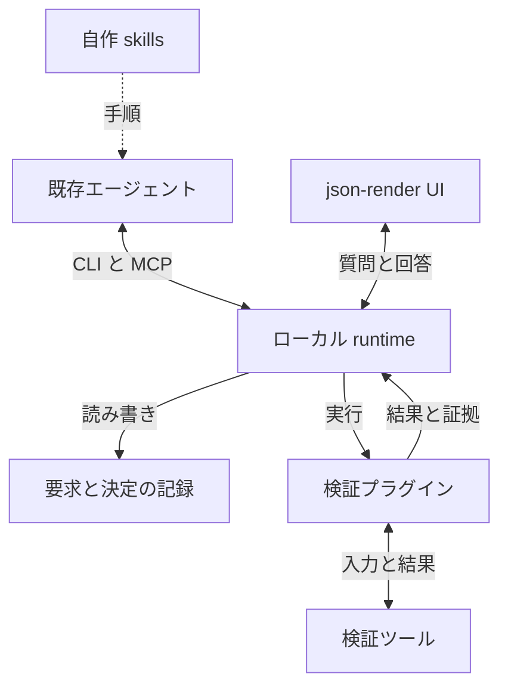

2026年11月8日時点の会話を引き継ぐための記録。目標は、曖昧なプロダクトの意図を整理し、要求、設計、検証可能な仕様、実装、検証結果までをつなぐ仕組みを自作すること。

**BMADとPDD Kitを導入する話には戻さない。形式検証の対象言語とツールはプラガブルにする。** これがユーザーの明示した方針。現在の構成案は、既存エージェント、自作skills、ローカルruntime、Markdown中心の記録、json-renderの判断用UI、検証プラグインを組み合わせるもの。

現状は調査と構成の検討まで。実装、インストール、リポジトリの作成、検証バックエンドの実行は未着手。以下では、ユーザーが決めた方向と助手が提案した具体構成を区別する。

# 決定済みの方向と構成案

| 区分 | 内容 |
| - | - |
| ユーザーの明示決定 | BMADもPDD Kitも利用できない前提で、自分たちで仕組みを作る。既存製品の導入案に戻さない。 |
| ユーザーの明示決定 | 形式検証の対象言語は複数あるため、言語や検証ツールを交換・追加できるようにする。RustやVerusに固定しない。 |
| ユーザーが求めている範囲 | 仕様化より前の整理から実装までを扱う。一般的な質問やブレインストーミングだけで必要な工程をカバーできるかを重視する。 |
| 対話から引き継ぐ要求 | AIが調査、具体案、比較、モデル化を先に進め、人間に考える作業を丸投げしない。判断と理由を別セッションでも再利用できる形で残す。 |
| ユーザーが提示した候補 | json-render。助手は判断用UIの基盤として適していると評価し、直近の構成案に組み込んだ。採用・実装の明示的な確定指示はまだない。 |
| 助手の現在の構成案 | 既存エージェント＋自作skills＋一つのローカルruntime＋Markdown等の記録＋React/json-render UI＋CLI/MCP＋検証プラグイン。 |
| 具体化が必要な部分 | プロジェクト名、リポジトリ、最初に接続するエージェント環境、最初の検証対象言語・ツール、詳細なデータ形式とAPI。TypeScript/Node.js/Reactも構成提案の段階。 |

専用Webアプリやエディタを最初から作ることは決定していない。小さなWeb UIを判断のために使う案と、独立したエージェント製品や共同編集SaaSを作る案は、規模も責務も異なる。

# 判断に至った経緯

## Chopinから始まった疑問

最初の関心は、GitHub Nextの[Chopin](https://githubnext.com/projects/chopin/)が何をするものか、使えるか、似たものはあるか、という話だった。共同で計画・仕様を扱い、AIとのやりとりや決定を残す体験が出発点になった。

その後、ユーザーから「単にMarkdownを共有し、AIとやりとりし、決定事項を記録するskillにすればよいのでは」という指摘があった。ここで、価値の中心を専用エディタの存在から、対話の進め方と継続可能な記録へ移した。代替サービスも調べたが、採用したものはない。

## 対話のUIと工程の充足性を分けた

ユーザーは、answer-me-with-htmlとgrill-meを組み合わせ、HTML上で選択し、まとめた返答をエージェントへコピーできる例を提示した。[answer-me-with-html](https://github.com/QingYunA/answer-me-with-html)は、こうした判断用UIをskillと組み合わせる参考例になった。

助手は当初、skill、HTML、決定ログでかなり足りると説明した。しかしユーザーの問い直しにより、**対話を便利にできることと、要件定義から実装までの必要事項を網羅できることは別**だと修正した。

[grill-me系の手順](https://raw.githubusercontent.com/mattpocock/skills/main/skills/productivity/grilling/SKILL.md)や[Superpowersのbrainstorming](https://raw.githubusercontent.com/obra/superpowers/main/skills/brainstorming/SKILL.md)は、論点の掘り下げ、選択肢の検討、設計の整理などに使える。ただし、質問を展開するだけでは、最初の論点集合に要求の抜けがないとはいえない。これらは工程の中で使う技法として扱い、全体の骨格を別に用意する判断になった。

## 仕様化より前の工程を要求工学として整理した

ユーザーが指していた「要件定義→なんか→仕様」の間には、要求の分析、モデル化、妥当性確認がある。要求工学では、要求の獲得、分析、仕様化、妥当性確認、管理を扱う。[SWEBOK](https://www.computer.org/education/bodies-of-knowledge/software-engineering/topics)と[ISO/IEC/IEEE 29148](https://www.iso.org/standard/72089.html)が参照軸になった。

さらに、誰のどんな問題を解くか、なぜその要求が必要かを扱うプロダクト探索と、目標から要求を導く考え方を上流に置く。[Design Councilの枠組み](https://www.designcouncil.org.uk/resources/framework-for-innovation/)や[Goal-Oriented Requirements Engineering](https://webperso.info.ucl.ac.be/~avl/files/RE01.pdf)は、この整理の参考である。特定の方法論をそのまま導入すると決めたわけではない。

具体的には、利用者と関係者、通常・例外シナリオ、用語、データ、状態と遷移、業務規則、品質要求、制約、優先順位、受入条件、要求の根拠を明示する。全案件を同じ手順に押し込まず、案件の性質に合わせて適用範囲を選ぶ。

人間とAIが合意しただけでは、現実に必要とされる機能だと確かめたことにはならない。重要な仮説には、調査、試作、利用者の反応などの証拠を対応させる。工程の整備は見落としを減らすためのもので、絶対的な網羅性の保証ではない。

## PDD Kitの役割を残しつつ自作へ修正した

ここでのPDD KitはGitHub Nextの[Proof-Driven Development](https://githubnext.com/projects/pdd-kit/)を指す。同名の別プロジェクトと取り違えない。

PDD Kitを単なる詳細設計の道具と捉える説明も修正した。参考にするのは、意図の明確化と人による確認から、形式的な仕様、実装と証明、実際の検証へつなぐ流れである。形式仕様の精密さと、実装方式を細部まで決める詳細設計は同じものではない。

助手は一度「上流をBMAD、下流をPDD Kitで扱う」と提案したが、ユーザーは「BMADもPDD Kitも使えないので自分で作成する」と明示した。したがって現在の目標は、**上流の要求整理と、PDD相当の仕様・実装・検証ループを、自作の一つの仕組みとして接続すること**。BMADとPDDは参考事例であり、導入依存ではない。

検証に通すために要求を黙って弱める運用は避ける。要求の誤りを発見した場合は、その要求と判断理由を改めて見直す経路へ戻す。

## json-renderは判断用UIに位置づけた

ユーザーが[json-render](https://github.com/vercel-labs/json-render)を候補として提示した。確認した役割は、用意したcatalogに従うUI JSONを生成し、登録したコンポーネントとアクションで表示・操作すること。[catalog](https://json-render.dev/docs/catalog)、[registry](https://json-render.dev/docs/registry)、[data binding](https://json-render.dev/docs/data-binding)が実装の参照先になる。

質問、案の比較、要求レビュー、仕様レビュー、検証結果の提示に向いている。一方、要求の意味、意思決定の確定、記録の保存、工程の進行、検証結果の判定は自作側で管理する。UI JSONはその時点の表示を表し、要求や仕様の正本にはしない。

json-renderには通信フックやMCP向けの機能もあるため、通信機能まで全部作り直す必要があるとは限らない。ただし、どの案件・セッションへの回答か、何を確定するか、どう永続化するかというアプリケーション上の意味は、自作側で接続する。

# 現時点の全体構成案

構成の中心は、既存エージェントにskillsを与え、一つのローカルruntimeが記録と検証実行を管理すること。人間は必要なときに判断用UIを開く。エージェントとの通常の会話、調査、コード編集には既存環境を使う。

| 部分 | 担当すること | 実装候補 |
| - | - | - |
| 既存エージェント | 調査、候補作成、分析、設計、実装、仕様や証明の記述 | Codex等。最初の接続先は未確定 |
| 自作skills | 必要な観点、進め方、成果物、レビューの手順 | Markdown、テンプレート、参考資料 |
| 共通モデル | 要求、判断、質問、仕様、証拠のIDと関連を定義 | TypeScriptとスキーマ |
| ローカルruntime | 状態管理、更新時の版確認、Q/A保存、待機・再取得、検証ジョブ実行 | TypeScript/Node.js |
| CLIとMCP | 既存エージェントからruntimeを操作する入口 | 同じruntimeに接続する薄い入口 |
| 判断用UI | 質問、比較、レビュー、検証結果、反例の表示 | React＋json-render |
| 検証プラグイン | 言語・手法固有の仕様記述支援、実行、出力解釈 | 対象ごとの設定、ガイド、runner、parser |

初期案はローカル中心。独自のLLMホストや新しいチャット製品を作ることは初期構成に含めない。

CLI、MCP、UIがそれぞれ同じファイルへ独立に書き込むと競合するため、管理対象の要求・判断・Q/A状態は一つのruntimeを経由して更新する。共通ライブラリを使うだけでは書き込みの一元化にはならない。外部エディタによる変更は版の変化として検出する。コードやネイティブ仕様などを含む厳密な管理境界は、API具体化時に定める。

# 自作skillsが扱う工程

名前と分割は仮。ユーザーが毎回すべてのskillを選ぶ運用にせず、一つの入口からエージェントが必要な工程を選ぶ。skillは指示文だけに限定せず、必要に応じてスクリプトやCLI/MCPの操作手順も組み合わせる。

| 工程 | 主な作業 | 残すもの |
| - | - | - |
| Discover | 誰の何の問題か、現状、利用場面、価値、代替手段、仮説を調べる | 問題の整理、根拠、仮説、非目標 |
| Requirements | 通常・例外の振る舞い、用語、データ、状態、規則、品質要求、制約を整理する | 根拠付きの要求、優先順位、受入条件、未決事項 |
| Design | UX、責務分割、アーキテクチャ、データ、外部連携を比較する | 設計案、採否と理由、トレードオフ |
| Specify | 要求を検査可能な主張へ変換し、適切な表現を選ぶ | 契約、状態モデル、不変条件、形式仕様、テスト条件、前提と対象外 |
| BuildとVerify | 実装・証明・テストを作り、実際のツールで検査する | コード、証明、テスト、実行結果、反例、修正記録 |
| Review | 各工程の抜け、矛盾、要求との対応、証拠の不足を確認する | 未解決事項と次に必要な調査・判断・検証 |

Reviewは最後だけに行わない。仕様化や検証で問題が見つかれば、要求や設計へ戻る。

各工程には、必要な観点と終了条件を用意する。該当する観点を「決定済み」「仮説」「未検証」「対象外」などで明示し、空欄のまま完了扱いにしない。具体的な状態名と遷移は未確定。

人間に聞く前に、AIが既存資料とコードを調べ、候補と推奨理由を作る。人間には、目的、優先順位、価値判断、許容するトレードオフ、調査では得られない情報を確認する。質問だけを繰り返して思考負荷を人間へ移す設計にはしない。

# 記録と版の扱い

現在の案は、Gitで扱いやすいファイルを中心にし、同じ意味を持つDBとMarkdownを二重の正本にしない構成。

| 記録 | 形式の案 | 意味 |
| - | - | - |
| 目的、要求、設計、意思決定理由 | Markdown＋固定frontmatter | 人間が読める正本。安定したIDと参照を持つ |
| 質問と回答 | 構造化JSON | 何を、どの版に対して質問し、何が回答されたか |
| ネイティブ仕様と証明 | 各検証手法のファイル形式 | 言語や手法の意味を保った検証入力 |
| 実装とテスト | 対象言語の通常のファイル | 実際に検査する実装とテスト |
| 検証実行記録 | JSON＋生ログや反例 | 対象、実行環境、方法、範囲、結果、証拠 |
| json-render用JSON | 正本と現在の文脈から生成 | 表示のための派生データ |

要求ID、判断ID、仕様中の主張、検証実行を相互に参照できるようにする。例として、ある要求について「なぜ採用したか」「どの仕様に対応するか」「どの版を何で検査したか」を追える状態が必要。

承認はレビューした版に対して記録する。仕様やコードが変わったあとで、以前の承認や検証成功を現在の版の結果として流用しない。過去の証拠は履歴として残し、現在の版への適用可否を分けて管理する。

ハッシュや版の記録は、前提と対象を特定するために使う。意味的な正しさやファイルの改ざん防止がそれだけで保証されるとは扱わない。

# UIからエージェントへ回答を戻す流れ

1. エージェントが、質問ID、対象の版、選択肢、推奨案、自由記述欄を含む依頼をruntimeに登録する。

2. runtimeが依頼を保存し、ローカルUIに表示する。

3. エージェントは回答待機用のtoolを呼ぶ。

4. 人間が回答すると、runtimeが対象の版を確認して、まず回答を永続的に保存する。

5. 待機中の接続があれば、保存した回答をtoolの返り値として渡す。

6. 切断やタイムアウトが起きた場合も回答を残し、次の継続時に未処理の回答を再取得する。

「回答を保存した」「エージェントが受け取った」「判断として反映した」は別の状態として扱う。requestId、質問のrevision、answerIdなどで対応づけ、同じ回答を再取得しても二重に適用しない。正式なAPI名とスキーマは未確定。

**MCPのtoolが呼ばれたことだけで、停止した任意のエージェントを自動再開できるとは限らない。** 初期案は、接続中の待機と、切断後に再取得できる記録を成立させるもの。完全な自動再開が必要なら、対象エージェントの起動・継続APIに合わせた接続を別途設計する。

json-renderの[MCPパッケージ](https://github.com/vercel-labs/json-render/blob/main/packages/mcp/README.md)は表示の統合候補。ただし[MCP Apps](https://modelcontextprotocol.io/extensions/apps/overview)への対応はホスト側にも必要で、通常のMCP toolが使えるだけでUI埋め込みまで使えるとはしない。まずローカルブラウザで回答の保存と再取得を成立させ、Appsへの統合を後から検討する構成案である。

# 形式検証をプラガブルにする境界

プラグインはコマンド実行だけを包むものにはしない。エージェントが対象手法に合った仕様や証明を書くための知識と、機械が実行する検査を組み合わせる。

| 要素 | 内容 |
| - | - |
| capabilities | 対象言語、対応する性質、検証方法、必要環境、制約 |
| guidance | ネイティブ仕様、契約、不変条件、証明、harnessの書き方とテンプレート |
| runner | 実際の検証ツールの起動、進捗、タイムアウト、キャンセル |
| parser | ツール出力を共通の証拠記録に変換し、生ログや反例を保持 |

エージェントは仕様やコードを書く。成功判定は実際に実行したツールの出力から作る。エージェントの「検証済み」という文章だけで成功状態にしない。

共通化する中心は、すべての仕様を一つの言語に翻訳することではなく、**どの主張を、どの対象に、どの条件で、どの方法で確認したかという証拠の形式**である。

検証結果には少なくとも、要求・仕様のID、対象artifactの種類、仕様・コード・設定の版、検証ツールとバージョン、方法、結果、前提、対象範囲、探索境界、対象外、ログや反例への参照を含める。依存関係など結果に影響する入力も特定できるようにする。

| 結果の種類 | 扱い |
| - | - |
| 契約や性質の証明 | 明示した前提と信頼する構成要素のもとでの証明として記録 |
| モデルの検査 | 検査したモデルと構成の結果として記録。実装との対応は別に必要 |
| 有界検査で反例なし | 調べた境界を明記。無制限の証明と混同しない |
| テスト成功 | 実行したテストと条件の範囲の結果として記録 |
| 未証明やタイムアウト | 未解決として記録。直ちに実装のバグとは断定しない |
| tool errorや未対応 | 検査自体の失敗や能力の不足として区別 |

例えば、[Verusの信頼境界](https://verus-lang.github.io/verus/guide/tcb.html)、[TLA+とモデルの関係](https://lamport.azurewebsites.net/tla/model-popup.html)、[CBMCの境界付き検査](https://raw.githubusercontent.com/diffblue/cbmc/develop/doc/cprover-manual/cbmc-tutorial.md)の違いを、単一のpass/failへ潰さない設計が必要になる。

ネイティブの仕様言語は維持する。同じプロジェクト内で複数の検証手法を使えるようにし、初期から万能な中間仕様言語やプラグイン市場を作り込まない。最初の対象言語・検証ツールはまだ選んでいない。

# 実装へ進むときの順序

現在提案している順序は次のとおり。

1. 要求・判断・質問のIDと版を持つ記録、runtime、UIでの質問と回答、保存後の再取得を作る。

2. 上流のskillsをつなぎ、問題の整理から要求・設計・仕様まで、一件の具体例を通す。

3. 一つ目の検証プラグインを作り、仕様、実装、実際の検査、要求に結びついた証拠までを接続する。

4. 性質の異なる二つ目の検証手法を追加し、一つ目に都合のよい抽象化になっていないかを確かめる。

5. 実例に基づいて、工程、UI部品、検証プラグイン、必要ならMCP Apps連携を広げる。

最初に通す単位は「一つの要求について、人間の判断、検査可能な仕様、実装、実行結果までが対応づくこと」。大きな方法論一式や独立したチャット製品の完成を先に目指さない。

最初の例では、理由と根拠が残ること、古い版への回答を誤適用しないこと、切断しても回答が失われないこと、検証結果から対象と範囲をたどれることを確認する。

# 次のセッションで具体化する項目

| 項目 | 現在の状態と次の判断 |
| - | - |
| 名前と作業場所 | プロジェクト名とリポジトリは未指定。既に存在するものがあればユーザーの指定を使う |
| エージェント接続先 | Codex等を想定しているが、最初に対応するホストと接続方法は未確定 |
| 開発技術 | TypeScript/Node.js、React、json-renderは現構成案。環境と要件に合わせて具体化する |
| 最初の題材 | 小さなプロダクト例と、最初に検証する性質を選ぶ |
| 検証バックエンド | 対象言語と性質から最初の一つを選ぶ。プラガブル方針は維持する |
| データとAPI | frontmatter、JSON、ID、revision、状態、runner結果の厳密なスキーマを定める |
| 配布と起動 | ローカル中心の案を前提に、導入、起動、既存リポジトリへの組み込みを具体化する |

今回の依頼は引き継ぎのまとめ。ここまでの会話を実装完了や全技術選定の承認として扱わない。一方、「自作する」「検証言語とツールをプラガブルにする」という決定を未定に戻して聞き直す必要もない。

# 引き継ぎ時に維持する判断

- BMADやPDD Kitのインストール・導入提案から再開しない。必要な機能と工程を自作する話を続ける。

- grill-me、brainstorming、HTML出力だけで全工程の十分性を保証しない。これらは工程内の技法として使える。

- PDD相当の意図・仕様・実装・検証ループを、上流の要求整理と接続する。PDDを話から消さない。

- json-renderは判断用UIの基盤。要求の正本、永続化、工程管理、検証器として扱わない。

- 特定の形式仕様言語へ固定しない。証明、モデル検査、有界検査、テストの意味と適用範囲を保つ。

- 人間に質問するだけの仕組みにせず、AIが調査と具体案の作成を先に進める。

- 現時点では構成検討まで。実装済みのファイル、動作確認済みの連携、選定済みの検証器を捏造しない。

次のセッションへ渡す際の要約文は次のとおり。

> プロダクトの曖昧な意図から、要求、設計、検査可能な仕様、実装、検証結果までをつなぐ仕組みを自作したい。BMADとPDD Kitは利用しない。形式検証の対象言語・ツールはプラガブルにする。現構成案は、既存エージェント＋自作skills＋単一のローカルruntime＋Markdown中心の記録＋React/json-render UI＋CLI/MCP＋検証プラグイン。上流には要求工学の観点を組み込み、下流にはPDD相当の仕様・実装・検証ループを置く。判断と理由、版、要求から証拠への対応を残し、人間には候補と推奨理由を示す。構成案の個別技術は未確定で、実装は未着手。この経緯を前提に、次の具体化から続けてほしい。
