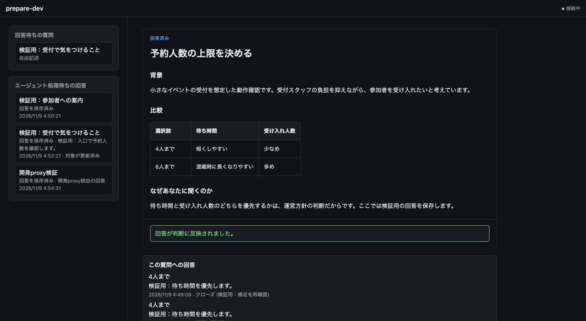

# UIとCLI配布物の実装・検証（2026-11-09）

Reactの判断画面とCLI tarballを実装し、ソースcheckoutの外へ置いた配布物で、質問作成・ブラウザ回答・判断反映・仕様作成・実装・検証・traceまで通した。json-renderと必須MCP登録は除去済み。

## 配布物

- `dist/prepare-dev-0.1.0.tgz`（2,101,281 bytes）
- SHA-256: `69aa524c38903b8a9065b381df0b2b90299bd126b562dcdedc398608931dfe04`
- Node.js 26以上。検証環境はmacOS arm64、Node.js 26.13.0。
- CLIのJavaScript bundle、単一HTMLのUI、7つのskills、Vitest/Leanの接続処理とguidance、第三者ライセンスを同梱。
- `npm install -g ./prepare-dev-0.1.0.tgz` で導入可能。元のcheckout、tsx、workspaceの依存解決は不要。検証器自体は対象側に必要。
- 再作成は `pnpm run package`。`dist/artifact.json` に生成物の場所とハッシュを残す。npmレジストリへは公開していない。

## 変更した動作

UIは背景・比較表・判断理由をMarkdownで描画し、候補の帰結・推奨理由と回答欄をReactで表示する。単一選択、複数選択、自由記述を扱い、空回答と送信中の再送を防ぐ。失敗時は入力を保持する。接続成功時には一覧と選択質問を再取得し、初回接続失敗からも復帰する。回答が閉じられた場合や古くなった場合も最新状態に追従する。

質問作成時の画面JSON入力と旧 `/api/questions/:id/ui` を廃止した。既存質問の旧uiデータは保存互換のため読み込めるが表示には使わない。

CLIの`init`はskillsをコピーし、既存の変更を上書きせず差異を報告する。MCP設定は作らない。`record put`は読んだ版とハッシュを必須引数にし、競合時は拒否する。起動はプロジェクトごとのTCP leaseで排他し、配布物の版と設置場所を検査する。停止受付後は新しい変更や検証開始を拒否する。

## 実行した検査

| 検査 | 結果・範囲 |
| --- | --- |
| `pnpm typecheck` | 成功 |
| `pnpm test` | 9ファイル、26テスト成功 |
| 配布物テスト | 3テスト成功。別フォルダへの展開、起動、skillsコピー・編集保持、MCP設定非変更、更新競合、質問・回答・判断・trace、実Lean検証、同時起動、停止、移設後の再起動 |
| Vite開発用proxy | 実サーバー経由の質問作成201・回答201、異なるOrigin403 |
| `git diff --check` | 成功 |
| 配布検証時点の記録 | [RUN-0009](../runs/RUN-0009.json): 29/29テスト成功、SPEC-0001・0003・0004の13主張がverified。この実行時点の対象版への適用可を確認 |

RUN-0009では深さ6の2,000 trace・12,000 stepを実装と照合し、failure 0。中断回復の48 traceも成功した。モデルの4主張を証明した既存の [RUN-0007](../runs/RUN-0007.json) も対象版への適用可のままである。

配布物テストの再実行は `pnpm test:package`。ブラウザ操作は以下に分けて記録し、サーバーやSSRのテストをブラウザ操作の証拠にはしていない。

## 別プロジェクトの一連の利用

一時ディレクトリにtarballを置き、Nodeプロジェクトへローカル依存として導入し、Vitest 5.1.0を用意した。記録・質問はすべて検証用データである。

1. CLIで「予約の受付人数」という要求を作り、Markdownの比較表と4人・6人の候補を持つ質問を作成。
2. 配布されたUIをChromeで開き、4人と補足を回答。保存済み・処理待ちを確認。
3. CLIで一度回答をcloseし、再読み込みなしで入力欄が戻ることを確認して再回答。
4. CLIでwait→ack→applyを実行。画面が「回答が判断に反映されました」に更新された。
5. 選ばれた上限4人をSPECにし、正の安全な整数かつ4以下を受け付けるTypeScript関数とVitestを作成。
6. 配布CLIの`verify run --plugin vitest ... --wait`で実行。成功・現在版への適用可を確認し、traceで要求→判断→仕様→検証結果が結び付くことを確認。
7. 要求を更新すると、先ほどの検証は`claim_requirement`の版不一致により適用不可になることを確認。古い証拠を現在版の保証として扱わない。

証拠は [検証成功時の結果](REC-0006/verification-result.json)、[その時点のtrace](REC-0006/trace-result.json)、[要求更新後の適用判定](REC-0006/verification-after-edit.json)。Leanは配布物の自動テストで別のプロジェクトを作り、`min(requested, capacity) ≤ capacity`を実際のLakeで証明した。Leanの証明とTypeScriptのテストは別の保証として扱う。

## ブラウザで確認した経路

- Markdownの見出し・比較表・推奨理由、補足として折りたたまれた関連記録。
- 単一選択、複数選択の2候補、自由記述の保存。
- 初回API/SSE接続が503になる状態から、再読み込みなしで質問が表示されること。
- 送信時の503でエラーと元の入力が残り、復帰後に再送できること。
- close後の再回答、CLIでapplyした結果のライブ表示。
- 古い回答のapply拒否後に、注意表示と再回答欄へ切り替わること。
- 存在しない質問URLでも一覧は表示され、一覧から正常な質問へ移れること。

通信障害は検証専用のローカルproxyで再現した。最後の無効URL・復帰確認と画面保存には上記SHA-256の最終tarballを使用した。初回復帰・送信・close・staleの操作確認は、最終版と同じフォーム・再接続処理を含む直前の候補でも実施した。

## レビューと修正

REV-0042〜0045で、CLI引数の不足、portableなskill参照、停止受付の競合、Vite Origin、初回取得失敗、回答状態の追従、取得失敗の分離を指摘した。すべて修正し、REV-0046〜0048の新規コンテキストレビューで新しいBlocker/Majorがないことを確認した。ブラウザで見つけたSSE初回503からの復帰も修正した。

契約はREQ-0009・REQ-0010、DES-0003、SPEC-0004。以前の6件の齟齬の修正は [整合性検証記録](REC-0005.md) に残す。過去の判断・RUNは履歴として保持し、対象版が変わったものの警告を消すために記録を書き換えない。

その後、M2までの仕様・記録を整理し、REQ-0009・0010のcoverageを補った。受入条件と配布物は同じだが、要求の版は進んでいる。[RUN-0010](../runs/RUN-0010.json)で29テスト・13主張の成功と現在版への適用可を再確認した。詳細は [M2の完了確認](REC-0003.md) を参照する。

## 保証の範囲

実機確認はmacOS arm64。テストは実行したケースの範囲、Lean証明は記録したモデル・前提の範囲である。Windows/Linuxでの実操作や、npm公開、複数利用者向けのWeb運用は今回の範囲に含めない。検証用daemonと通信proxyは停止済み。

## 添付

| ファイル | sha256 |
| - | - |
| REC-0006/release-ui.jpg | 64cf03661dbf647932459c8e59e66370d7ce87e9bf8e4151a970470c3efd563c |
| REC-0006/trace-result.json | f77e0797d27ef91a1f930a2516527726e059014404575b8f74fab85408b2295f |
| REC-0006/verification-after-edit.json | c3e671d2e9c03ee95ebe20f68453431a45c9ad1d082e74563ef897871bf37243 |
| REC-0006/verification-result.json | 3b66ca414577f4a93380b5d255274eac08a9aa0768c67056d9cd48a953ab81f6 |
